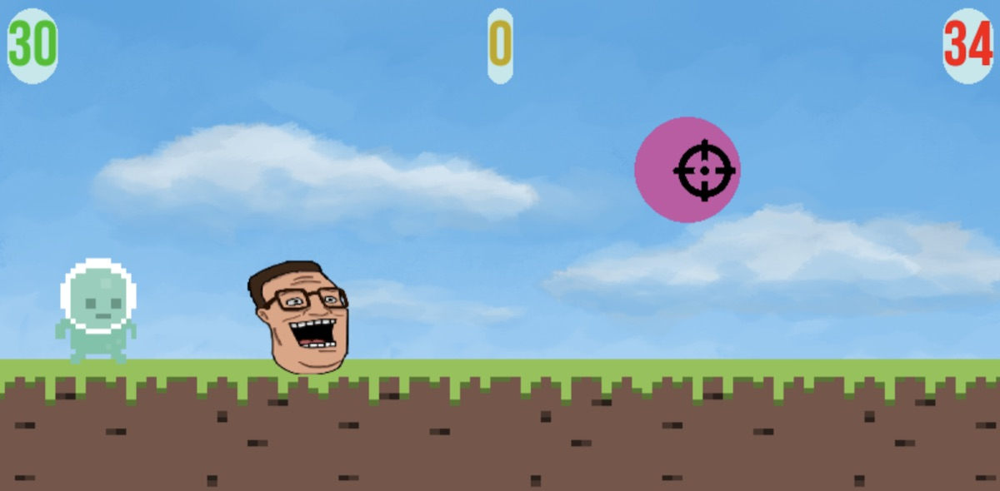

# Første Pygame-prosjekter

De første spillene jeg laget i Python og Pygame.

| Sirkelspillet | Klassequiz |
|---|---|
|  |  |

- **Sirkelspillet.py** – skytespill der du treffer sirkler med musen. Poeng og rekord lagres i `lagringSkytSirkel.txt` mellom hver gang spillet kjøres.
- **Klassequiz.py** – julequiz med flervalgsspørsmål, besvart med musen.
- **forsteOving.py** – den aller første øvingen i Pygame.

## Kjør

Kjør fra denne mappen, siden spillene laster bilder, lyd og fonter med relative stier.

```bash
pip install pygame
python Sirkelspillet.py
```
